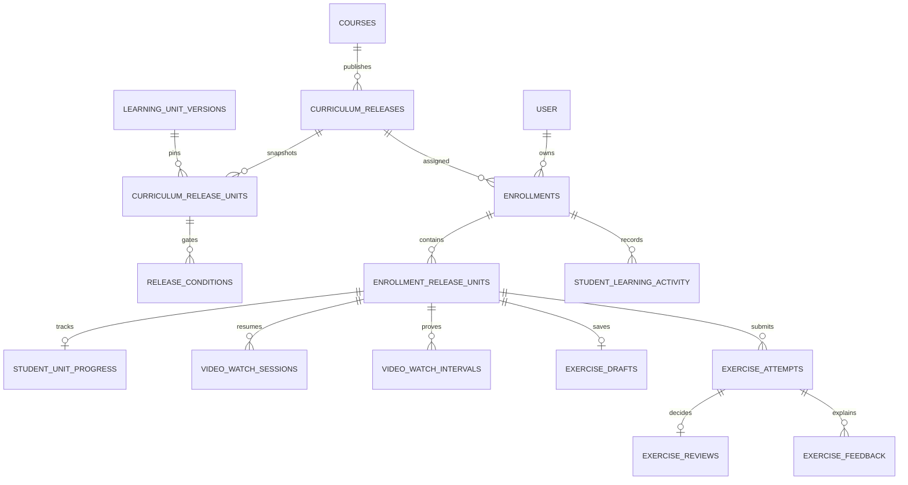
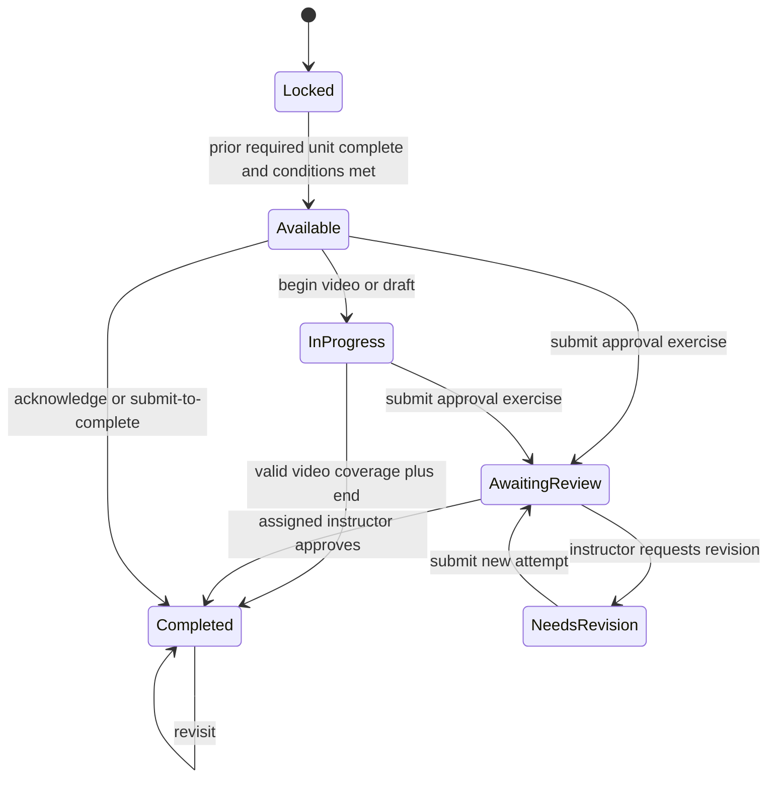

# M2 learning engine and data relationships

The PostgreSQL API implements ordered learning through immutable course releases. The existing SQLite student application remains available for browser regression checks; the React shell is not a migrated student interface.

## Relationships and ownership

`enrollments.student_id` comes from a verified student account. Student APIs derive that identity from the Better Auth session. `enrollment_release_units` pins the assigned release units; progress, video records, drafts, attempts, notes and activity refer to the composite enrollment/release-unit assignment. SQL migration `0007` adds composite foreign keys and same-release triggers so a row from another release cannot be attached to an enrollment. Portfolio creation requires an active enrollment and stores its ID. Existing M1 artifacts retain a nullable enrollment ID for migration compatibility; they remain owner-readable but cannot be edited without an active matching enrollment.

## Publishing and enrollment

The administrator prepares weeks, days, chapters, learning units and version rows in the database test harness. The M2 publishing endpoint accepts ordered ready unit-version IDs, required flags, duration, content and conditions. It verifies each version belongs to the course, snapshots those values in one transaction, records a publish event, and increments the course release number. PostgreSQL triggers reject update/delete of published releases, release units and conditions, and reject changes to published version content fields. A later publish creates a new release.

Admin enrollment chooses the latest release, inserts the enrollment and all assigned units in one transaction, and records `enrolled`. One enrollment per student/course is allowed. A suspended enrollment preserves work but cannot open units or mutate learning records. Suspending and recording its event share a transaction. Existing enrollments never switch releases on publish. A managed release migration endpoint is not implemented; production migration must be explicit and reviewed.

## Availability and progression

The server orders a student's assigned release units. A required unit blocks later required units until completed. Optional units do not block successors. Explicit release conditions additionally require a prerequisite to be completed, to have a first attempt, or to have an approved review. Feedback units can be revealed by their explicit condition while an exercise awaits review. Completed units remain readable. A locked unit's payload returns 404, including direct URL access. Roadmap completion is `completed required units / assigned required units`, with separate day totals derived from the unit hierarchy.

## Completion policies

| Policy | Submission result | Unlock rule |
| --- | --- | --- |
| `submit_to_complete` | Completed | Next required unit can unlock |
| `feedback_then_continue` | Submitted | A gated feedback unit must be acknowledged before the exercise completes and the next required unit unlocks |
| `instructor_approval` | Awaiting review | Next required unit waits for an assigned instructor's approval |
| `revision_required` | Awaiting review | The first attempt cannot be approved; a revision creates a new immutable attempt before approval |

A draft or note uses a revision number; stale writes return 409. Attempts are immutable rows with increasing attempt numbers. Feedback and decisions refer to the exact attempt. The instructor must retain a privileged role and an exact staff/student/course assignment at review time.

Enrollment activity history is ordered by event time and ID. Its cursor is accepted only when it belongs to the same enrollment, so one student's cursor cannot expose or page through another student's history.

## Video test adapter

M2 returns `adapter: test-video` and the pinned duration; no media URL or Cloudflare credential is exposed. Events are accepted only for the current active session, owned enrollment and unlocked unit. A new session invalidates earlier sessions and resumes the saved position. Forward watched coverage is bounded by server elapsed time at a maximum 2x playback rate. Seek events change position without creating coverage. Overlapping intervals are merged for percentages; repeated heartbeats at the same position add no coverage. Completion requires at least 90% distinct coverage and a valid end event near the pinned duration. Actual media authorization belongs to M3.

## Migration and rollout

Migrations `0005` and `0006` create the M2 schema and portfolio enrollment link; `0007` adds integrity constraints and immutable-release triggers; `0008` constrains states and policy values. Apply from an empty disposable PostgreSQL database first. No production database or SQLite data was migrated. The SQLite importer, backup and rollback rehearsal remain required before a cutover. Keep the old application available until feature parity and data migration are verified.
